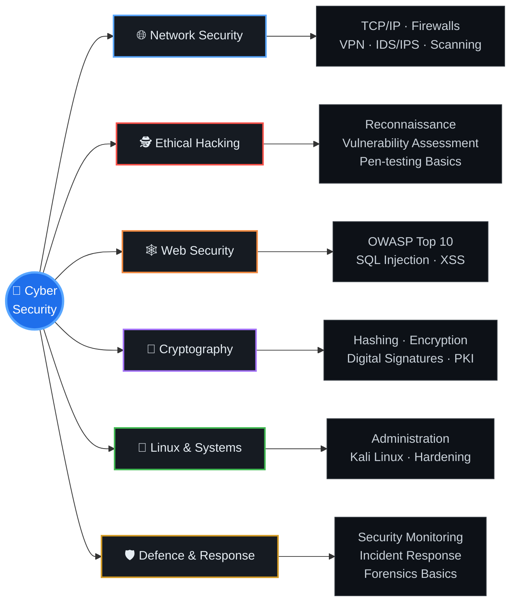

<picture>
  <source media="(prefers-color-scheme: light)" srcset="https://www.gitskins.com/api/section/hero?username=thisishritik&theme=aurora&avatar=https%3A%2F%2Favatars.githubusercontent.com%2Fu%2F337048592%3Fv%3D4&variant=living-identity&label=Hritik%20Kumar&v=wow-living-identity-1&mode=light" />
  
</picture>

---

## 👋 About Me

I'm **Hritik Kumar**, a BCA student from Saharsa, Bihar, building a strong base in computer science with one clear goal: to become a **cybersecurity expert**.

My plan: complete **BCA**, then pursue **MCA** for deeper technical skills and **MBA** for management and leadership, so I can protect systems *and* lead security teams.

Outside of computers, I enjoy **fitness and bodybuilding**. The same discipline applies to both.

---

## 🗺️ My Journey

  

---

## 🎓 Diplomas & Certifications

  

---

## 🛠️ BCA Skills

**Programming Languages**

<picture>
  <source media="(prefers-color-scheme: light)" srcset="https://skillicons.dev/icons?i=c,cpp,java,py&theme=light" />
  
</picture>

**Web Development**

<picture>
  <source media="(prefers-color-scheme: light)" srcset="https://skillicons.dev/icons?i=html,css,js&theme=light" />
  
</picture>

**Database, Tools & Platforms**

<picture>
  <source media="(prefers-color-scheme: light)" srcset="https://skillicons.dev/icons?i=mysql,git,github,linux,bash,vscode&theme=light" />
  
</picture>

**Core Computer Science Subjects**

---

## 🔐 Cybersecurity Focus

Currently learning and practising the foundations of security:

**Tools I'm exploring**

---    
 **SPORTS **

## 🌐 Connect With Me

